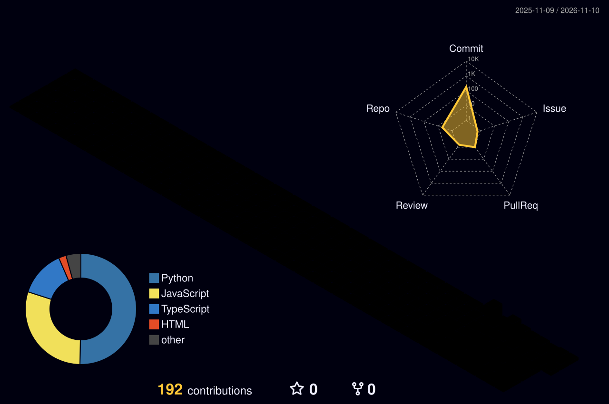

---

## 👨‍💻 Обо мне

- 🎓 Учусь в **УрФУ** на направлении «Алгоритмы искусственного интеллекта»
- 🐍 Сам пишу на **Python**; веб- и мобильные проекты делаю вместе с ИИ (вайб-кодинг)
- 🧠 Расту в сторону **ML**: NumPy, нейросети, алгоритмы
- 🎮 Люблю делать то, во что можно **поиграть или попользоваться**
- 📆 Учебные проекты довожу до конца: например, 70 дней — 70 коммитов
- 🌱 Сейчас изучаю: алгоритмы, анализ данных, нейронные сети

---

## 🛠 Стек

---

## 🚀 Проекты

<table>
  <tr>
    <td width="50%" valign="top">
      <h3><a href="https://github.com/filinhoo-afk/doeshfridge">🧊 doeshfridge</a></h3>
      Навигатор по холодильнику: продиктуй продукты голосом, а приложение подберёт рецепты из того, что есть. Android, работает офлайн, без аккаунтов.  
      
    </td>
    <td width="50%" valign="top">
      <h3><a href="https://github.com/filinhoo-afk/Survive_or_die">⚔️ Survive_or_die</a></h3>
      Аркада-выживач на чистом JavaScript и Canvas: бегай по карте, отбивайся от толп врагов, качай апгрейды. Без фреймворков и сборки. Учебный проект: 70 дней — 70 коммитов.  
      
    </td>
  </tr>
  <tr>
    <td width="50%" valign="top">
      <h3><a href="https://github.com/filinhoo-afk/self-study">📚 self-study</a></h3>
      План и практика самообучения: Python, алгоритмы, данные, ML.  
      
    </td>
    <td width="50%" valign="top">
      <h3><a href="https://github.com/filinhoo-afk/urfu-redesign">🎨 urfu-redesign</a></h3>
      Конкурсный прототип для конкурса «Взломай веб-дизайн университета» — УрФУ.  
      
    </td>
  </tr>
</table>

---

## 📊 Статистика

---

## 🧊 Мои коммиты в 3D

---

## 🐍 Змейка ест мои коммиты

